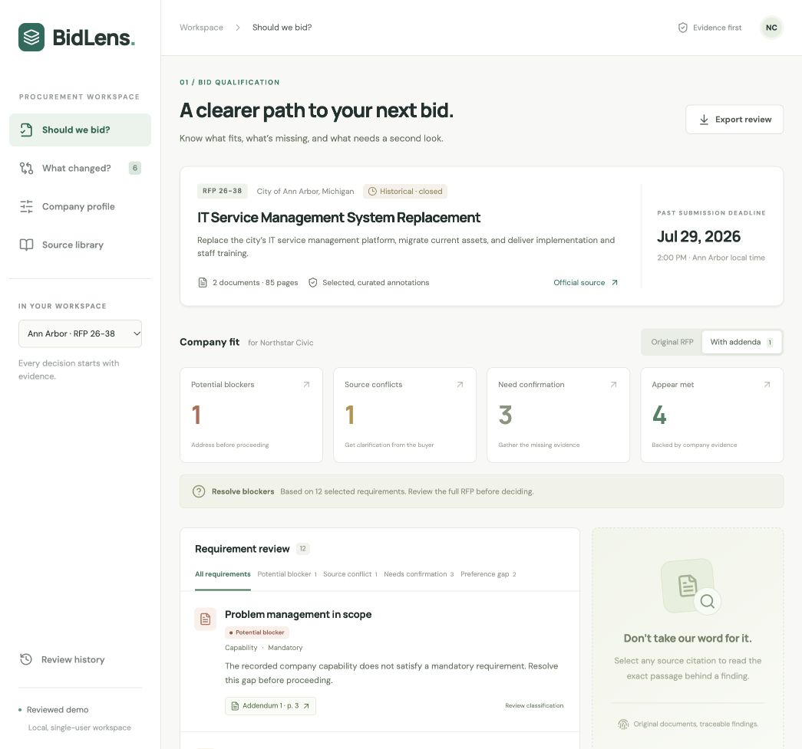
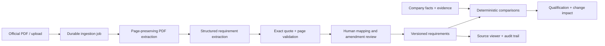

# BidLens

**Know whether a government opportunity fits your company—and whether an amendment changes the answer.**

A small vendor can spend days preparing a proposal before noticing one disqualifying requirement. A last-minute amendment can change the scope, introduce a new gap, or contradict an earlier answer. BidLens turns those documents into a reviewable decision with source evidence attached.



## Two tools, one evidence trail

- **Should we bid?** Compare individual requirements with company capabilities. Separate potential blockers, missing evidence, source conflicts, preferences, and requirements that appear met.
- **What changed?** Compare requirement versions and show their consequences for the same company profile. Preserve originals, require explicit amendment mappings, and keep uncertainty visible.

Click a citation to see the exact quote highlighted on its original PDF page text. Update the company profile to re-evaluate dependent findings. Review a classification or map a live extraction; every change creates an audit event. Export a cited Markdown review for a teammate.

## Try it locally

Requires **Python 3.12**, **Node.js 22+**, and **pnpm 10.28.2**. The demo needs **no API key, no Docker, and no network after installation**. Fonts fall back to system fonts offline.

```bash
git clone https://github.com/viraajnindra/bidlens.git
cd bidlens
python3.12 -m venv .venv
source .venv/bin/activate
pip install -r requirements.lock
pip install --no-deps -e .
npm install -g pnpm@10.28.2
pnpm --dir frontend install --frozen-lockfile
cp .env.example .env
python scripts/dev.py
```

Open **http://127.0.0.1:3000**. Interactive API docs are at **http://127.0.0.1:8000/docs**. Ctrl+C stops the website, API, and worker. The pinned local environment targets macOS/Linux; on Windows, use WSL2 or Docker.

The checked-in snapshot includes all 85 pages of source text and reviewed annotations. To enable the embedded original PDF view:

```bash
python scripts/download_sources.py
```

This downloads only the two cited government PDFs and checks their SHA-256 hashes. If an upstream file changes, the script stops instead of silently changing the evidence. Official source links remain available without local downloads.

### A 90-second demo

1. Open **Should we bid?**, then **Original RFP**: 0 potential blockers, 2 missing confirmations, 5 requirements that appear met, and 1 preference gap.
2. Switch to **With addenda**: Problem Management becomes a potential blocker, while Microsoft's integration wording becomes a source conflict.
3. Open **What changed?**. Read Answer 5 on page 2 beside Answer 9 on page 3: one uses **or**, the other lists both integrations as required.
4. In **Company profile**, change **Problem management module** to Yes and add supporting evidence. Save. That blocker resolves; the unrelated source conflict remains. Only dependent comparisons are recalculated.
5. Open a citation, inspect the source, export the review, and inspect **Review history**.

The company is fictional. The procurement documents and quoted passages are real. The example is a **closed, historical opportunity**, not a current lead.

## Real public data

City of Ann Arbor **RFP 26-38: IT Service Management System Replacement**:

| Source | Pages | What it demonstrates |
| --- | ---: | --- |
| [Original RFP](https://www.a2gov.org/media/b2gno2i0/rfp_26-38_document.pdf) | 35 | Functional requirements, implementation obligations, proposal forms |
| [Addendum 1](https://www.a2gov.org/media/mv0jeano/rfp_26-38_addendum1.pdf) | 50 | Migration clarification, Problem Management scope, preferences, conflicting integration answers |
| [Official procurement index](https://www.a2gov.org/finance-and-administrative-services/purchasing/request-for-proposals/) | — | Source discovery and provenance |

The reviewed demo deliberately covers **14 requirement versions, 12 active requirements, and 6 amendment findings**. It is not an exhaustive compliance extraction. `data/demo.json` holds the page text, source URLs, original hashes, citations, and annotations. `scripts/build_fixture.py` rebuilds those annotations from downloaded source pages. The fixture was reviewed during development; it is not presented as autonomous AI output.

## Import your own RFPs and amendments

1. Set `OPENAI_API_KEY` and `OPENAI_MODEL` in `.env`. Choose a model available to your account that supports Responses API Structured Outputs. Restart the API and worker.
2. In **Source library**, upload a PDF or enter an allowed government HTTPS PDF URL. Give it a title and agency. The worker extracts page text and structured, cited findings.
3. Open the completed review. Use **Map & verify** to connect a finding to a company capability, or leave it for manual review when its conditions cannot be represented safely. Classification corrections are separate.
4. Import an amendment into that opportunity, in official order. New findings do **not** automatically overwrite existing ones. A reviewer must explicitly link a replacement to an earlier requirement or flag a source conflict.
5. Return to **What changed?** to see the before/after company impact. Both sides use the same current company profile.

Model output must pass schema validation **and exact quote/page validation**. Unsupported quotations fail the job. The default extractor accepts text PDFs; image-only or partly unreadable documents fail visibly instead of producing a partial successful result. Optional Docling OCR can be enabled with `pip install -e '.[ocr]'` and `PDF_ENGINE=docling` (large optional dependency; not exercised in the default verification).

Imports are bounded to 20 MB / 150 pages. PDF text is sent to the configured OpenAI provider. API keys stay server-side. URL downloads allow only configured government hosts, public IPs, and HTTPS, with redirects disabled. Uploaded documents do not require a public URL.

## How it works



**Next.js / TypeScript** frontend, **FastAPI / Pydantic** API, **SQLAlchemy** persistence, a separate Python worker, **pypdf** extraction, and optional **OpenAI Structured Outputs**. SQLite powers local startup; Docker Compose uses PostgreSQL.

An assessment cache key includes the engine version, requirement version and reviewed interpretation, and only the company facts used in that comparison. A profile change therefore invalidates affected findings without rerunning PDF extraction or the language model. Human reviews are append-only and version scoped. See [architecture and design tradeoffs](docs/ARCHITECTURE.md).

## Verification

```bash
pytest -q --cov=backend --cov-report=term-missing
ruff check --config pyproject.toml backend tests scripts
ruff format --check --config pyproject.toml backend tests scripts
pnpm --dir frontend format:check
pnpm --dir frontend build
```

Tests cover real fixture citations, mandatory vs preferred language, missing evidence, conflict preservation, version-scoped corrections, dependency-based invalidation, stale profile writes, upload validation, worker recovery, bounded retries, and a complete mocked-provider original → amendment → reviewed mapping → changed assessment flow.

[Verification notes](docs/VERIFICATION.md) distinguish local checks from integrations requiring credentials or services. No paid live model call is claimed without a configured API key. CI runs backend checks and the production frontend build on every push.

## Docker / PostgreSQL option

```bash
cp .env.example .env
docker compose up --build
```

Open the same local URL. The database and uploaded PDFs persist in named volumes. Use `docker compose down` to stop the stack. This option requires a running Docker engine; the local quickstart does not.

## Scope and next steps

- This is a local, single-user prototype. Do not expose it as a multi-tenant service without authentication, tenant isolation, quotas, migrations, and operational monitoring. `BIDLENS_API_TOKEN` protects direct API access if set; the default web proxy does not attach it.
- Company evidence is self-reported and not independently authenticated. “Appears met” means the recorded facts satisfy the reviewed rule, not that a buyer will accept a bid.
- Live extraction and amendment mappings need human review. Exact quotation validation checks grounding, not semantic completeness. Cross-page clauses, tables, exceptions, and long conditions need careful inspection.
- The selected demo is an evaluation case, not evidence of extraction accuracy across jurisdictions. No estimated budgets or unsupported eligibility thresholds are invented.
- With another week: build a broader labeled evaluation set; add reviewer-assisted matching suggestions, robust OCR/table handling, official-document discovery with change polling, and pilot with a small vendor to measure review time and missed requirements.

A timed [five-minute walkthrough script](docs/WALKTHROUGH.md) explains the problem, the demo, the difficult decisions, and the next week of work. Record it in Loom for submission.

Code is [MIT licensed](LICENSE). Government source documents and quoted text retain their original attribution.
